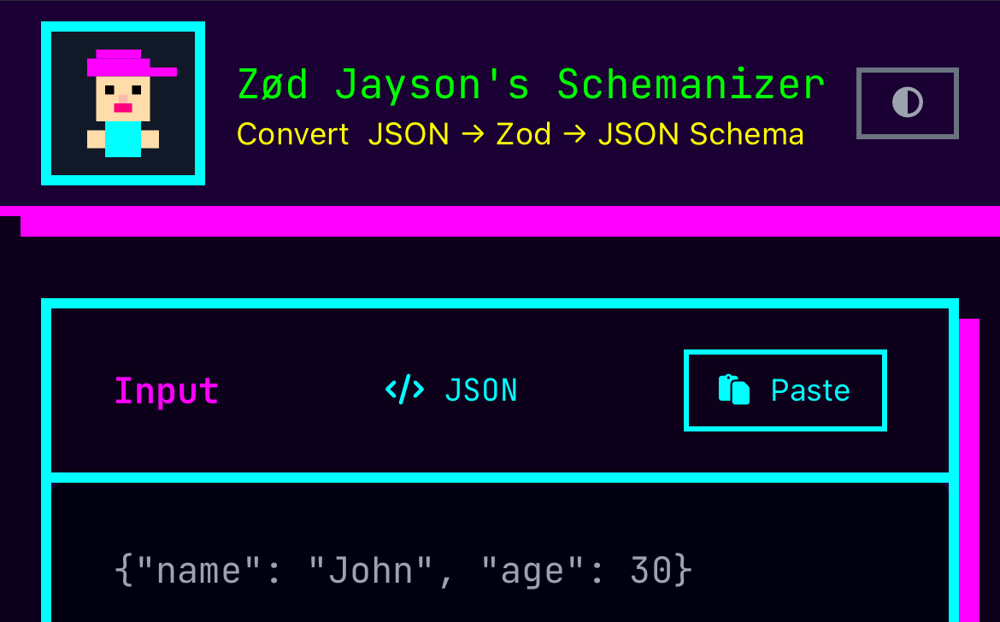
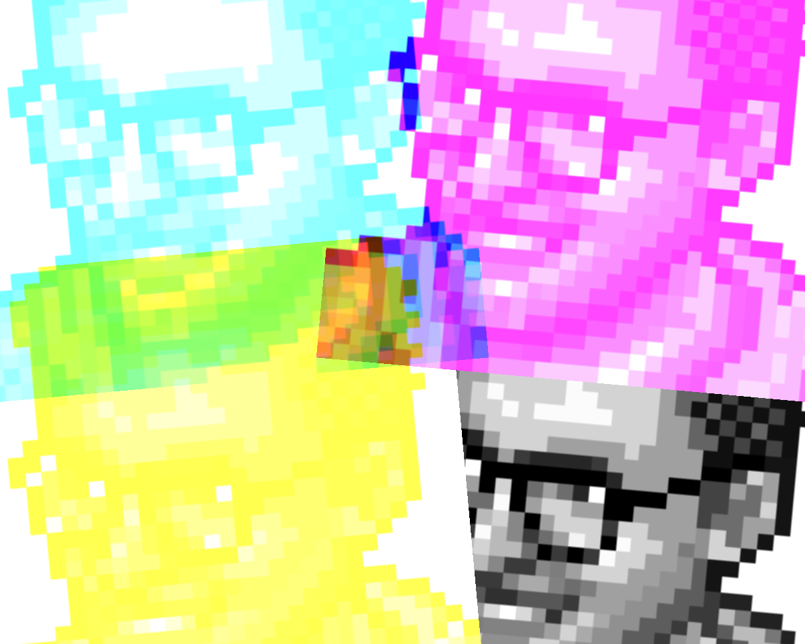
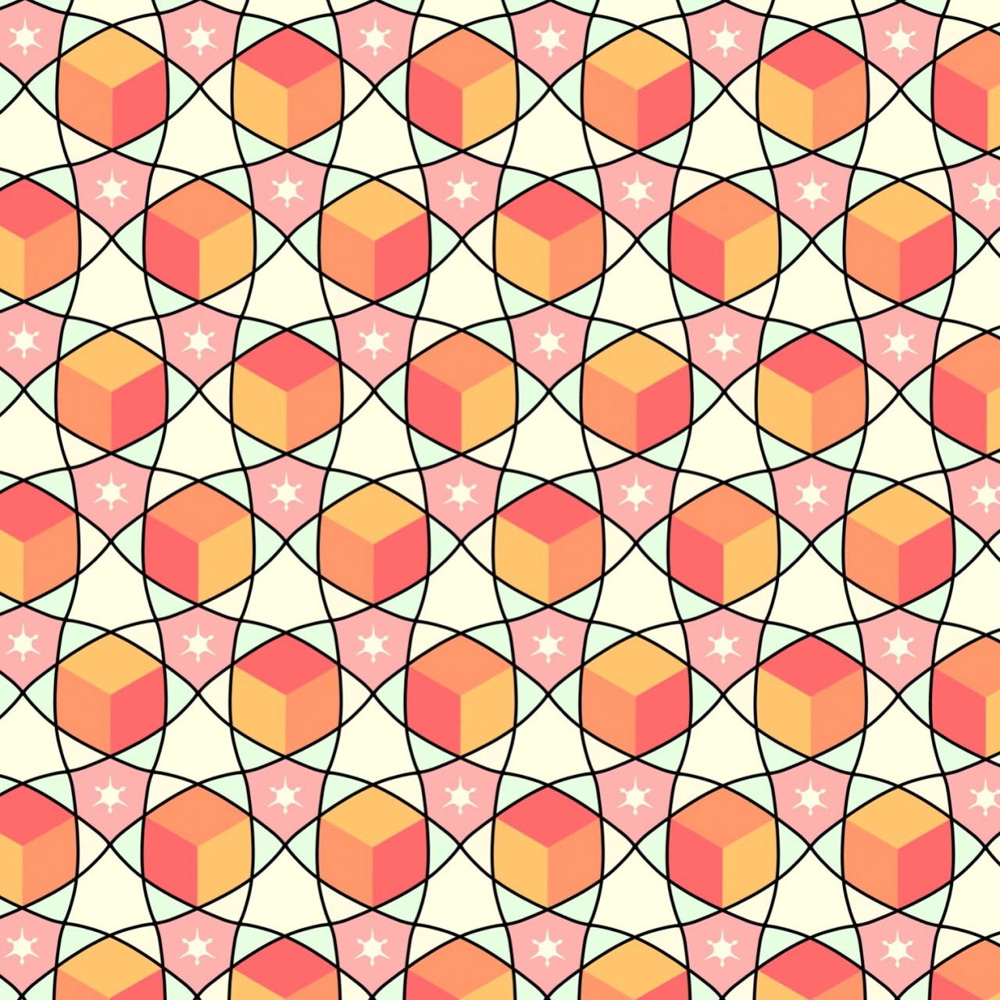
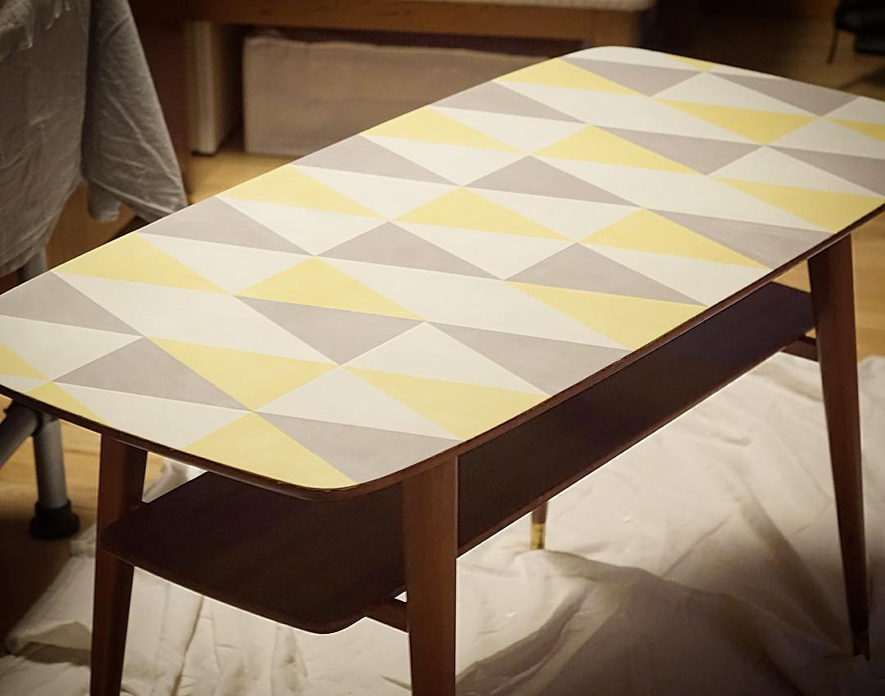
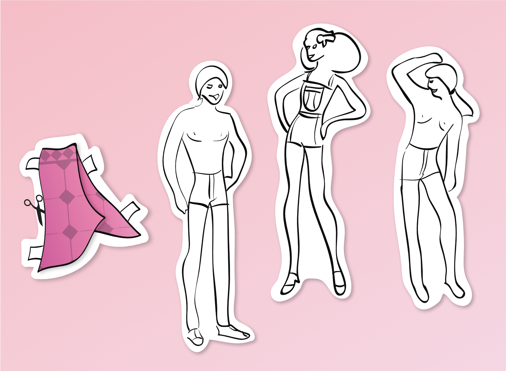
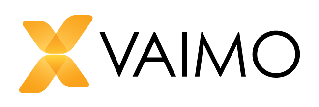

# pontus.cc

**Hi, I'm Pontus Sundén.**
I enjoy the creativity in graphic design,
[programming](https://github.com/psu), pop culture and internet.

I live with my family in
Gothenburg, Sweden.

---

# Pontus Sundén

**Node.js/Express micro-API**

Zød Jayson's Schemanizer - Convert from JSON to Zod Type to JSON Schema.

**Browser extension**

_Shortlet - Tinker with Websites_ let you create shortcuts and custom commands for interacting with your favourit websites.

[github.com/psu/shortlet](https://github.com/psu/shortlet)

**UI Mods**

A collection of _Zen Mods_: small UI tweaks for the new [Zen Browser](https://zen-browser.app), based on Firefox.

[github.com/psu/zen-mods](https://github.com/psu/zen-mods)

**Javascript**

_Text2Tana_ is a small parser that takes a single line of text and convert it to the JSON format used by [Tana Input API](https://tana.inc/docs/input-api).

[github.com/psu/text2tana](https://github.com/psu/text2tana)

**CSS**

The CMYK-split is an exercise in CSS animation and visualization.

**iOrnament**

**Adobe After Effects**

[Animated marketing content (video)](assets/fhv-stress.mp4)

**Chalk Paint**

**Adobe Illustrator**

**My 9 to 5**

---

[`pontus@psu.se`](mailto:pontus@psu.se) /
[`linkedin`](https://linkedin.com/in/pontussunden) /
[`github`](https://github.com/psu) /
[`@pontus@mas.to`](https://mas.to/@pontus)
